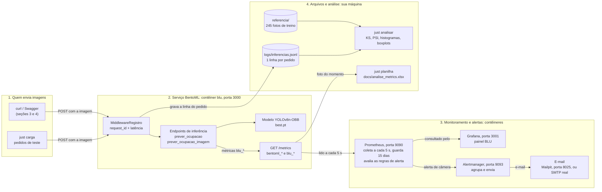

# BLU — Serviço de detecção de ocupação de vagas

Vertente MLOps do projeto BLU: uma API que recebe uma imagem de estacionamento
e devolve o estado de cada vaga (LIVRE ou OCUPADA), servida com BentoML sobre
um modelo YOLOv8-OBB treinado pela equipe.

## Visão geral: arquitetura e fluxo



### O caminho de um pedido

1. O cliente (curl, Swagger ou `just carga`) envia a foto em `POST
   /prever_ocupacao` ou `/prever_ocupacao_imagem` (`multipart/form-data`,
   campo `imagem`) para a porta 3000.
2. O **`MiddlewareRegistro`** (`src/blu_service/monitoramento.py`) recebe o
   pedido primeiro: cria um `request_id` e começa a medir o tempo.
3. O **BentoML** abre o arquivo como imagem PIL. Se não for imagem, responde
   **400** ali mesmo; o pedido ainda assim vai para o log (passo 7).
4. O **endpoint** (`src/blu_service/service.py`) faz a análise:
   - mede a imagem: luminância, contraste, nitidez e histograma;
   - roda o **modelo** (`model.py`): caixas `vaga` e `carro`;
   - aplica a **regra de negócio** (`logic.py`): `vaga` vira LIVRE e `carro`
     vira OCUPADA, com contagem e taxa de ocupação;
   - resume a saída (vagas, confiança) e marca a imagem como suspeita se
     estiver borrada, escura, estourada ou sem as 7 vagas;
   - atualiza as métricas `blu_*` do `/metrics`.
5. A **resposta** volta ao cliente: JSON ou imagem anotada (`render.py`), com o
   cabeçalho `X-Request-ID`.
6. O **BentoML** atualiza as próprias métricas no `/metrics`: contagem por
   código HTTP e histograma de latência.
7. O **middleware** grava **uma linha** em `logs/inferencias.jsonl` com tudo o
   que entrou e saiu, o status e a latência total.
8. A cada 5 s, o **Prometheus** lê o `/metrics` e guarda o histórico. O
   **Grafana** consulta o Prometheus e atualiza o painel.
9. O **Prometheus** também avalia as regras de alerta
   (`monitoramento/alertas.yml`). Se mais de 30% das imagens dos últimos 5
   minutos estiverem borradas, escuras ou estouradas, o que indica um provável
   problema na câmera, ele avisa o **Alertmanager**, que manda um **e-mail**
   para a equipe.

Depois, fora do caminho do pedido:
- `just analisar` compara o log com a referência (fotos de treino) por KS e
  PSI;
- `just planilha` transforma uma foto do `/metrics` em histograma, boxplot e
  taxa de erros.

### Onde cada informação fica

| Onde | O que guarda | Para que serve | Por quanto tempo |
|---|---|---|---|
| `logs/inferencias.jsonl` | cada pedido, com o que entrou e saiu | investigar um pedido; histogramas, boxplots, KS/PSI | até 6 arquivos de 10 MB |
| `GET /metrics` | totais desde que o serviço subiu | foto do momento; planilha | até o serviço reiniciar |
| Prometheus | o `/metrics` a cada 5 s | evolução no tempo, taxas por minuto | 15 dias |
| Grafana | nada (consulta o Prometheus) | painel ao vivo | — |
| Alertmanager | alertas ativos e silêncios | avisar a equipe por e-mail | enquanto o contêiner existir |
| Mailpit | e-mails de alerta (caixa local) | ver os e-mails sem conta de e-mail | até o contêiner ser recriado |

### Dois modos de rodar

| | Tudo em contêiner (recomendado) | Serviço na máquina |
|---|---|---|
| Subir | `just docker` (1ª vez) + `just up` | `just serve` + `just monitor-up` |
| Serviço | contêiner `blu`, porta 3000 | processo local, porta 3000 |
| Prometheus, Grafana, Alertmanager, Mailpit | contêineres, portas 9090, 3001, 9093 e 8025 | contêineres, portas 9090, 3001, 9093 e 8025 |
| Log | `./logs/inferencias.jsonl` (pasta montada) | `./logs/inferencias.jsonl` |
| Parar | `just down` | Ctrl+C no `serve` + `just down` |

Os dois usam a porta 3000, então não rode os dois ao mesmo tempo. O passo a
passo completo do monitoramento está na [seção 6](#6-monitoramento-log-em-arquivo-metrics-prometheus-e-grafana),
os alertas por e-mail na [seção 6.6](#66-alertas-por-e-mail-problema-na-câmera),
e a lista de arquivos, em [Estrutura do repositório](#estrutura-do-repositório).

## 1. O que este serviço apoia

O Project Charter do BLU (Entendimento do Negócio, fase de Otimização)
descreve duas decisões apoiadas por este sistema:

- **Gestor de mobilidade** (foco principal): consulta o padrão de ocupação de
  uma via ou região para decidir se ela precisa de ampliação, reorganização
  de vagas ou fiscalização mais intensa.
- **Motorista** (foco secundário): decide se vale a pena se deslocar até uma
  vaga sinalizada como livre.

Em nenhum dos dois casos o serviço age sozinho. Ele produz o `estado_vaga`
(LIVRE/OCUPADA) por leitura de imagem — o insumo de dados sobre o qual a
decisão humana é tomada, não a decisão em si. Cobrança automática, aplicação
de multa e identificação de motorista/veículo estão fora do escopo.

A unidade de análise é a vaga, não o veículo: o modelo não reconhece placas
nem identifica carros individualmente, apenas classifica o estado de cada
vaga na imagem.

## 2. Do clone à primeira predição

**Pré-requisitos:** `git` e **Python 3.11 ou superior** já instalado na
máquina. 

Clone o repositório e instale o `uv` pelo
[requirements.txt](requirements.txt):

```bash
git clone <url-do-repositorio>
cd BLU-MLOPS

# Linux / macOS
python3 -m pip install --user -r requirements.txt

# Windows (PowerShell)
python -m pip install -r requirements.txt
```

Confira se ficou no PATH:

```bash
uv --version
```

> Se aparecer "comando não encontrado" ou "não é reconhecido", **feche e
> reabra o terminal**. No Linux, se continuar, adicione `~/.local/bin` ao PATH
> com `export PATH="$HOME/.local/bin:$PATH"`.
>
> Em Debian 12+/Ubuntu 23.04+ o pip pode recusar com
> `externally-managed-environment`. Nesse caso use
> `python3 -m pip install --user --break-system-packages -r requirements.txt`.
> O comando instala só para o seu usuário e não mexe nos pacotes do sistema.
> Outra opção é o instalador oficial, que dispensa o Python:
> `curl -LsSf https://astral.sh/uv/install.sh | sh`.

Instale as dependências do projeto:

```bash
uv sync
```

Esse único comando cria o ambiente virtual em **`.venv/`** (usando o Python que
já está na sua máquina) e instala tudo que está fixado no `uv.lock` — incluindo
o [just](https://github.com/casey/just), via o pacote `rust-just`. **Não é
preciso criar a venv antes**: o `uv sync` faz isso por você, e criar uma à mão
pode acabar apontando para uma versão de Python diferente da que o projeto
espera.

Tempo esperado: **~2–5 minutos** na primeira vez, quase instantâneo nas
seguintes. O volume vem das dependências de visão computacional — o ambiente
final ocupa cerca de **935 MB**, sendo `torch` (~450 MB), o runtime do `polars`
(~170 MB) e o `opencv` (~110 MB) os três maiores.

### Ativar a venv (opcional, mas recomendado)

```bash
# Linux / macOS
source .venv/bin/activate

# Windows (PowerShell)
.venv\Scripts\Activate.ps1
```

Você saberá que funcionou porque o terminal passa a mostrar `(blu-service)` no
início da linha. Para sair, basta `deactivate`.

### Duas formas de rodar os comandos

Tudo neste README pode ser feito de duas maneiras equivalentes — escolha a que
preferir:

| | Sem ativar a venv | Com a venv ativada |
|---|---|---|
| Subir o serviço | `uv run just serve` | `just serve` |
| Rodar os testes | `uv run just test` | `just test` |
| Lint | `uv run just lint` | `just lint` |
| Ver todas as receitas | `uv run just --list` | `just --list` |

O prefixo `uv run` significa "execute isto dentro do `.venv` do projeto". Se a
venv já está ativada, o prefixo é dispensável — é exatamente o mesmo comando.

E o `just` é sempre apenas um atalho: cada receita do
[justfile](justfile) é um comando `uv` por baixo. Por exemplo, `just serve`
executa:

```bash
uv run python -m bentoml serve src.blu_service.service:BluService --port 3000
```

Ou seja, você nunca depende do `just` — se preferir, pode abrir o `justfile` e
copiar o comando direto. Os exemplos a seguir mostram as duas formas.

Suba o serviço:

```bash
# pelo atalho
uv run just serve

# ou, o comando completo por trás dele
uv run python -m bentoml serve src.blu_service.service:BluService --port 3000
```


O Swagger fica em `http://localhost:3000` assim que o log mostrar
`Service blu_service initialized` (leva alguns segundos após o servidor
subir, enquanto o modelo é carregado). Ele é útil para explorar a API. 

Rode a primeira predição (usa uma imagem de exemplo do repositório):

```powershell
# Windows (PowerShell) 
curl.exe -X POST http://localhost:3000/prever_ocupacao -F "imagem=@samples/exemplo_misto.jpeg;type=image/jpeg"
```

```bash
# Linux / macOS / Git Bash / WSL
curl -X POST http://localhost:3000/prever_ocupacao -F "imagem=@samples/exemplo_misto.jpeg;type=image/jpeg"
```

Tempo esperado por predição: **~0.3–1 s em CPU**.

## 3. Contrato da API

### `POST /prever_ocupacao`

BentoML expõe APIs de serviço como `POST`; não há rota `GET` neste estilo de
serviço.

**Entrada:** `multipart/form-data` com um campo `imagem` contendo o arquivo
de imagem (jpeg/png). No serviço, o parâmetro é tipado como imagem PIL
(`PIL.Image.Image`): o BentoML recebe o upload e entrega ao endpoint a imagem
já aberta, sem passar por caminho de arquivo.

**Saída (200):**

```json
{
  "timestamp": "2026-09-21T23:41:00.699576+00:00",
  "modelo": "best.pt (yolov8n-obb, ultralytics)",
  "total_vagas": 7,
  "livres": 3,
  "ocupadas": 4,
  "taxa_ocupacao": 0.5714,
  "vagas": [
    {
      "id": 0,
      "estado": "LIVRE",
      "confianca": 0.9281,
      "obb": [[677.47, 206.92], [682.91, 21.94], [211.26, 8.06], [205.82, 193.05]]
    }
  ],
  "vagas_descartadas_baixa_confianca": 0
}
```

- `estado`: `"LIVRE"` ou `"OCUPADA"`, mapeado diretamente das classes do
  modelo (`vaga` → LIVRE, `carro` → OCUPADA — ver seção 5).
- `obb`: os 4 cantos da caixa orientada, em pixels da imagem original.
- `vagas_descartadas_baixa_confianca`: detecções abaixo do limiar de
  confiança (`BLU_CONF_THRESHOLD`, padrão `0.25`), que **não** entram na
  contagem — alinhado à decisão de não estimar estado sob confiança baixa.

**Saída (400) — arquivo que não é imagem:** o BentoML recusa o upload ao
tentar abri-lo como imagem e responde com o seu formato padrão de erro de
validação:

```json
{
  "error": "1 validation error for Input",
  "detail": [
    {
      "type": "value_error",
      "loc": ["imagem"],
      "msg": "Value error, arquivo_invalido: o arquivo enviado não é uma imagem válida (jpeg/png)"
    }
  ]
}
```

**Saída (400) — imagem corrompida** (por exemplo, um JPEG truncado, que abre
mas não decodifica):

```json
{"erro": "arquivo_invalido", "detalhe": "image file is truncated (5 bytes not processed)"}
```

**Saída (503) — modelo indisponível:** `{"erro": "modelo_indisponivel", ...}`.

### `POST /prever_ocupacao_imagem`

Mesma entrada de `/prever_ocupacao` (`multipart/form-data`, campo `imagem`).
Em vez de JSON, devolve a própria imagem com as vagas desenhadas: contorno
**verde + "LIVRE"** para vagas livres, contorno **vermelho + "OCUPADA"** para
vagas ocupadas, cada rótulo com a confiança do modelo. Usa exatamente o
mesmo `ResultadoOcupacao` do endpoint JSON (mesmo limiar de confiança, mesmos
rótulos), então as duas respostas são sempre consistentes entre si — não é
o `result.plot()` bruto da ultralytics, que mostraria "vaga"/"carro" e
ignoraria o filtro de confiança.

```powershell
# Windows (PowerShell)
curl.exe -X POST http://localhost:3000/prever_ocupacao_imagem -F "imagem=@samples/exemplo_misto.jpeg;type=image/jpeg" -o resultado_anotado.jpg
```

```bash
# Linux / macOS / Git Bash / WSL
curl -X POST http://localhost:3000/prever_ocupacao_imagem -F "imagem=@samples/exemplo_misto.jpeg;type=image/jpeg" -o resultado_anotado.jpg
```

Abra `resultado_anotado.jpg` para ver o resultado.

## 4. Três casos de sucesso e um caso de erro

Com o serviço rodando, execute os comandos abaixo a partir da raiz do
repositório.

### Windows (PowerShell)

```powershell
# Caso 1 — maioria das vagas livres
curl.exe -X POST http://localhost:3000/prever_ocupacao -F "imagem=@samples/exemplo_livre.jpeg;type=image/jpeg"

# Caso 2 — maioria das vagas ocupadas
curl.exe -X POST http://localhost:3000/prever_ocupacao -F "imagem=@samples/exemplo_ocupado.jpeg;type=image/jpeg"

# Caso 3 — vagas livres e ocupadas na mesma imagem
curl.exe -X POST http://localhost:3000/prever_ocupacao -F "imagem=@samples/exemplo_misto.jpeg;type=image/jpeg"

# Caso de erro — arquivo que não é imagem (-i mostra o status HTTP)
curl.exe -i -X POST http://localhost:3000/prever_ocupacao -F "imagem=@samples/arquivo_invalido.txt;type=text/plain"
```

> Use **`curl.exe`**, não `curl`. No PowerShell, `curl` é apelido de
> `Invoke-WebRequest`, que não entende a flag `-F` e falha.

### Linux / macOS / Git Bash / WSL

```bash
# Caso 1 — maioria das vagas livres
curl -X POST http://localhost:3000/prever_ocupacao -F "imagem=@samples/exemplo_livre.jpeg;type=image/jpeg"

# Caso 2 — maioria das vagas ocupadas
curl -X POST http://localhost:3000/prever_ocupacao -F "imagem=@samples/exemplo_ocupado.jpeg;type=image/jpeg"

# Caso 3 — vagas livres e ocupadas na mesma imagem
curl -X POST http://localhost:3000/prever_ocupacao -F "imagem=@samples/exemplo_misto.jpeg;type=image/jpeg"

# Caso de erro — arquivo que não é imagem (-i mostra o status HTTP)
curl -i -X POST http://localhost:3000/prever_ocupacao -F "imagem=@samples/arquivo_invalido.txt;type=text/plain"
```

Os três primeiros devolvem `200` com o JSON descrito acima; o quarto devolve
`400` com o erro de validação `arquivo_invalido` (ver seção 3). Todos os
quatro foram testados manualmente contra o serviço real antes desta entrega.

Ou rode tudo de uma vez: `uv run just demo` (ou `just demo`, com a venv
ativada).

## 5. De onde veio o modelo servido

- Arquitetura: **YOLOv8n-OBB** (caixas orientadas — mais adequado que caixa
  alinhada para vagas fotografadas em ângulo), via
  [ultralytics](https://github.com/ultralytics/ultralytics) `8.4.60`.
- Ponto de partida: pesos pré-treinados `yolov8n-obb.pt` da ultralytics.
- Fine-tuning: pela equipe BLU, em CPU, sobre 245 imagens de uma **maquete**
  de estacionamento (`train-maquete/`), com 2 classes:
  - `0: vaga` → mapeada para o estado **LIVRE**
  - `1: carro` → mapeada para o estado **OCUPADA**

  Ou seja: o modelo já foi treinado para classificar o *estado* da vaga, não
  para detectar dois tipos de objeto a serem cruzados geometricamente. Cada
  detecção é uma vaga com seu estado; o serviço apenas traduz a classe
  predita para o rótulo `estado_vaga` do Charter (`src/blu_service/logic.py`).
- Os datasets de treino/validação (`train-maquete/`, `valid-maquete/`) não
  são versionados (ver `.gitignore`) por tamanho; ficam disponíveis
  localmente após o clone original ou sob pedido à equipe.


## 5.1. Problema conhecido no Windows: Smart App Control

Se ao subir o serviço aparecer:

```
DLL load failed while importing _C: Uma política de Controle de Aplicativo
bloqueou este arquivo.
```

o **Smart App Control** do Windows está bloqueando as DLLs do PyTorch, que não
são assinadas digitalmente. Para confirmar:

```powershell
(Get-ItemProperty "HKLM:\SYSTEM\CurrentControlSet\Control\CI\Policy").VerifiedAndReputablePolicyState
# 0 = desligado | 1 = ligado (bloqueia) | 2 = modo avaliação
```

Não é um problema do projeto: qualquer `import torch` nessa máquina falha do
mesmo jeito. Há dois caminhos:

1. **Rodar pelo container** (recomendado). Dentro do container é Linux, e a
   política não se aplica. O `bentoml build` funciona mesmo com o torch
   bloqueado, porque `src/blu_service/model.py` envolve o import da
   ultralytics em `bentoml.importing()` — isso marca o torch como dependência
   de *runtime*, necessária para atender requisições, mas não para o build
   inspecionar a API.
2. **Desligar o Smart App Control** (Windows Security → Controle de aplicativos
   e navegador → Smart App Control → Desativado) e reiniciar. ⚠️ É
   irreversível: só dá para religar reinstalando o Windows.


## 6. Monitoramento: log em arquivo, `/metrics`, Prometheus e Grafana

O serviço registra o que recebe e o que devolve de três formas:

- **Log em arquivo:** uma linha por pedido em `logs/inferencias.jsonl`. É
  daqui que saem histogramas, boxplots e a comparação com a referência
  (KS/PSI).
- **`GET /metrics`:** o endpoint do próprio BentoML, no formato Prometheus,
  com as métricas de imagem e de resposta do modelo (`blu_*`) acrescentadas.
  Como analisá-lo está em [`docs/metrics.md`](docs/metrics.md), com a
  planilha [`docs/analise_metrics.xlsx`](docs/analise_metrics.xlsx).
- **Prometheus + Grafana:** guardam o histórico do `/metrics` e mostram um
  painel ao vivo.
- **Alertmanager:** manda um e-mail quando a qualidade das imagens indica
  problema na câmera (seção 6.6).

### 6.1. Passo a passo: gerar carga e ver o rastro evoluir

Tudo roda em contêiner: o serviço, o Prometheus e o Grafana. O log em arquivo
continua aparecendo em `logs/`, na pasta do repositório, porque essa pasta é
montada dentro do contêiner do serviço. Use dois terminais na raiz do
repositório.

```bash
# Terminal 1: constrói a imagem do serviço (só na primeira vez, ou se o código
# mudar; leva alguns minutos) e sobe serviço + Prometheus + Grafana
uv run just docker
uv run just up
```

```powershell
# Terminal 2: acompanha o log enquanto ele cresce
Get-Content logs\inferencias.jsonl -Wait -Tail 3     # Windows (PowerShell)
tail -f logs/inferencias.jsonl                       # Linux / macOS / Git Bash
```

```bash
# Terminal 1: gera a carga
uv run just carga --n 200 --degradar
```

> **Sem Docker para o serviço:** rode `uv run just serve` no lugar de
> `just docker` e `just up`, e `uv run just monitor-up` para subir só o
> Prometheus e o Grafana. O resto do passo a passo é igual. Não rode os dois
> modos juntos: os dois usam a porta 3000.

O `just carga` envia 200 pedidos aos dois endpoints com as imagens de
`samples/`. Ele mistura de propósito:
- 10% de arquivos inválidos, que geram respostas 400;
- com `--degradar`, 30% de imagens borradas, escurecidas ou estouradas,
  degradadas no próprio cliente.

Opções úteis:

| Opção | Efeito |
|---|---|
| `--n` | quantidade de pedidos |
| `--intervalo` | segundos entre pedidos |
| `--fracao-erro` | fração de arquivos inválidos |
| `--degradar 0.5` | fração de imagens degradadas |
| `--tipo borrada` | só um tipo de degradação (`borrada`, `escura` ou `estourada`), para simular um defeito específico da câmera e disparar o alerta (seção 6.6) |
| `--pasta DIR` | outra pasta de imagens |

Enquanto a carga roda:

| Onde | O que ver |
|---|---|
| Terminal 2 | uma linha nova por pedido, inclusive os 400 |
| http://localhost:3000/metrics | os contadores `bentoml_*` e `blu_*` subindo |
| http://localhost:3001 | painel **BLU - Monitoramento** no Grafana (sem login; admin/admin para editar) |
| http://localhost:9090/targets | o Prometheus coletando o serviço (`host.docker.internal:3000`, estado `UP`) |
| http://localhost:9090/alerts | as regras de alerta de câmera e se alguma está disparando (seção 6.6) |
| http://localhost:8025 | a caixa de e-mail local (Mailpit), onde chegam os e-mails de alerta |

Depois da carga:

```bash
uv run just planilha     # foto do /metrics -> docs/analise_metrics.xlsx (histograma, boxplot, taxa de erros)
uv run just analisar     # log x referência: KS, PSI, histogramas e boxplots em analise/
uv run just down         # derruba os contêineres
```

Sem o `just`, os comandos equivalentes estão no [justfile](justfile), por
exemplo `uv run python scripts/gerar_carga.py --n 200 --degradar` e
`docker compose up -d`.

A carga, a planilha e a análise rodam na máquina e falam com o serviço pela
porta 3000. Funcionam igual com o serviço em contêiner ou fora dele.


### 6.2. O log em arquivo

- **Arquivo:** `logs/inferencias.jsonl`, no formato
  [JSON Lines](https://jsonlines.org/), com um pedido por linha. Lê-se direto
  no pandas com `pd.read_json(caminho, lines=True)`.
- **Append-only:** o `RotatingFileHandler` do `logging` só acrescenta linhas.
  Quando o arquivo passa de 10 MB, ele vira `inferencias.jsonl.1` (o `.1`
  anterior vira `.2`, até `.5`) e um arquivo novo começa. Nenhuma linha é
  reescrita. Os limites são configuráveis por `BLU_LOG_MAX_BYTES` e
  `BLU_LOG_BACKUPS`.
- **Um evento por pedido, inclusive os recusados:** o registro é feito por um
  middleware que envolve o app inteiro (`MiddlewareRegistro` em
  `src/blu_service/monitoramento.py`). Por isso entram no log até os pedidos
  que o BentoML recusa antes de chegar ao endpoint, como um arquivo que não é
  imagem. Rotas de infraestrutura (`/metrics`, `/readyz`, `/docs`…) ficam de
  fora.
- **Data e hora:** `ts` em ISO 8601 com **microssegundos e fuso horário**,
  mais `ts_unix` (segundos desde 1970, com 6 casas). O `request_id` da linha
  também volta ao cliente no cabeçalho `X-Request-ID`, para cruzar um pedido
  com sua linha.

Linha real (o histograma e a lista de detecções foram encurtados aqui):

```json
{
  "ts": "2026-11-15T21:27:37.981221-03:00", "ts_unix": 1794788857.981221,
  "versao_log": 1, "request_id": "4fe23922b725484bbef90fe9ee89a760", "pid": 17764,
  "metodo": "POST", "endpoint": "/prever_ocupacao", "status_http": 200,
  "latencia_total_ms": 4153.706, "latencia_modelo_ms": 4010.648,
  "modelo": "best.pt (yolov8n-obb, ultralytics)", "limiar_confianca": 0.25,
  "entrada": {
    "content_type": "multipart/form-data", "content_length": 111402,
    "formato": "JPEG", "modo": "RGB", "largura": 1310, "altura": 1600, "megapixels": 2.096,
    "luminancia_media": 170.9446, "luminancia_desvio": 63.306,
    "rgb_media": [175.2583, 168.621, 172.2986],
    "fracao_estourada": 0.000323, "fracao_escura": 0.003895, "nitidez": 320.2797,
    "histograma_l": [689, 743, 558, 763, "... 256 valores"]
  },
  "saida": {
    "total_vagas": 7, "livres": 3, "ocupadas": 4, "taxa_ocupacao": 0.5714,
    "descartadas_baixa_confianca": 0,
    "confianca_media": 0.8823, "confianca_min": 0.8047, "confianca_max": 0.9281,
    "confianca_media_livre": 0.8781, "confianca_media_ocupada": 0.8856,
    "vagas_esperadas": 7, "vagas_divergentes": false,
    "deteccoes": [{"estado": "LIVRE", "confianca": 0.9281, "area_rel": 0.041662, "cx_rel": 0.3392, "cy_rel": 0.0672}, "..."]
  },
  "alertas": [],
  "erro": null
}
```

Este foi o primeiro pedido depois que o serviço subiu, por isso a latência de
4 s: o modelo é carregado na primeira chamada. Na carga de exemplo, a maioria
dos pedidos seguintes ficou entre 0,1 e 0,5 s (ver `docs/metrics.md`).

Num pedido recusado (arquivo que não é imagem), `entrada` só tem
`content_type` e `content_length`, `saida` é `null` e `erro` traz o motivo:

```json
{"ts": "2026-11-15T21:09:15.032583-03:00", "...": "...", "endpoint": "/prever_ocupacao", "status_http": 400,
 "latencia_total_ms": 41.201, "latencia_modelo_ms": null, "entrada": {"content_type": "multipart/form-data", "content_length": 229},
 "saida": null, "erro": {"codigo": 400, "detalhe": {"error": "1 validation error for Input", "detail": [{"loc": ["imagem"], "msg": "Value error, arquivo_invalido: ..."}]}}}
```

#### Por que estas variáveis (CRISP-DM)

O serviço apoia a decisão do gestor de mobilidade e do motorista (seção 1)
com o estado de cada vaga. Essa informação só vale se a **imagem** que chega
se parece com a que o modelo viu no treino e se a **resposta** se comporta
como esperado. As variáveis cobrem os três pontos em que isso pode falhar.

| Grupo | Variáveis | Para que servem |
|---|---|---|
| **Entrada: iluminação** | `luminancia_media`, `luminancia_desvio` (contraste), `rgb_media`, `fracao_estourada` (pixels ≥ 250), `fracao_escura` (≤ 5), `histograma_l` (256 faixas) | A maquete é fotografada sob luz variável (sombra, contraluz, lâmpada). O `histograma_l` e a `luminancia_media` são as mesmas variáveis dos exemplos de KS (003) e PSI (008) da disciplina. |
| **Entrada: qualidade** | `nitidez` (ver 6.3), `content_length`, `largura`, `altura`, `megapixels`, `formato` | Câmera fora de foco, lente suja ou resolução trocada mudam o que o modelo vê. `content_length ÷ pixels` (bytes por pixel) denuncia compressão JPEG excessiva. |
| **Saída: resposta do modelo** | `total_vagas`, `livres`, `ocupadas`, `taxa_ocupacao`, `confianca_*`, `descartadas_baixa_confianca`, `vagas_divergentes`, `deteccoes` (estado, confiança, área e centro relativos de cada caixa) | Distribuição da ocupação (a informação de negócio) e da confiança (queda de confiança costuma vir antes do erro). A maquete tem 7 vagas fixas: um total diferente indica câmera deslocada, vaga encoberta ou falha do modelo. O centro e a área de cada caixa permitem detectar a câmera mexida. |
| **Operação** | `status_http`, `erro`, `latencia_total_ms`, `latencia_modelo_ms`, `endpoint`, `request_id`, `modelo`, `limiar_confianca`, `versao_log` | Erros e tempo de resposta por pedido, com a configuração em vigor (modelo e limiar), para comparar períodos. |
| **Diagnóstico** | `alertas` | Motivos pelos quais a imagem saiu da faixa da referência (`borrada`, `escura`, `estourada`, `vagas_divergentes`). |

### 6.3. Métrica de qualidade de imagem: nitidez

Além da iluminação, o serviço acompanha a **nitidez**: a variância do
Laplaciano da imagem em cinza, medida numa cópia com 640 px de largura para
não depender da resolução.

Por que esta métrica:
- a câmera da maquete é fixa e de foco fixo;
- o modelo depende das **linhas finas** que delimitam as vagas;
- foto fora de foco, lente suja ou câmera tremida apagam essas linhas, e a
  nitidez cai **antes** de o modelo começar a errar.

Medido nas imagens de `samples/`:

| Imagem | Nitidez | Luminância |
|---|---:|---:|
| `exemplo_livre` original | 136,4 | 127,6 |
| com desfoque gaussiano raio 2 | 13,6 | 127,6 |
| com desfoque gaussiano raio 4 | 3,0 | 127,6 |
| escurecida para 45% | 28,5 | 56,9 |
| clareada 1,8x | 299,8 | 203,5 (53% dos pixels estourados) |
| JPEG com qualidade 5 | 135,4 | 126,5 |

Uma imagem é marcada como suspeita quando sai da faixa das 245 fotos de
treino (`referencia/resumo.json`). Os limites são configuráveis pelo `.env`:

| Motivo | Regra | Origem do limite |
|---|---|---|
| `borrada` | nitidez < 15 | p1 da referência (14,5) |
| `escura` | luminância média < 100 | p1 da referência (106,5) |
| `estourada` | mais de 1% dos pixels ≥ 250 | máximo da referência: 0,07% |
| `vagas_divergentes` | vagas detectadas ≠ 7 | regra da maquete |

**Limitação:** compressão JPEG extrema **não** derruba a nitidez, porque os
blocos da compressão criam bordas novas (última linha da tabela). Esse caso
aparece nos bytes por pixel, que também vão para o log.

### 6.4. Conjunto de referência e drift (KS/PSI)

O enunciado sugere comparar o que chega ao serviço com o conjunto de
treinamento. Por isso `referencia/referencia.jsonl` passa as **245 fotos de
treino** (`train-maquete/images`) pelas mesmas funções do log e pelo modelo.
O arquivo tem o mesmo formato do log, e `referencia/resumo.json` traz os
percentis de cada variável. Como os datasets não são versionados, os dois
arquivos são; para refazê-los, use `just referencia`.

O que a referência revelou:
- **As fotos de treino são de celular, de perto:** só 67 das 245 (27%) mostram
  as 7 vagas. A regra `vagas_divergentes` vale para a câmera fixa de produção,
  não para o treino. Quando houver fotos do ESP32-CAM, a referência deve ser
  refeita com elas (`just referencia --pasta <fotos>`). É a "referência
  estabelecida manualmente" que o enunciado prevê.
- **As 25 imagens de `valid-maquete/` são as mesmas de `train-maquete/`**
  (mesmo nome e tamanho). A validação do modelo não mediu generalização.
- **`descartadas_baixa_confianca` é sempre 0:** a ultralytics já corta as
  detecções abaixo de 0,25 por padrão, igual ao limiar do serviço.

O `just analisar` compara o log com a referência, variável a variável:
- **KS:** `scipy.stats.ks_2samp`.
- **PSI:** 10 faixas pelos quantis da referência, a mesma construção do
  exemplo 008. Abaixo de 0,1 é estável; de 0,1 a 0,25, mudança moderada;
  acima de 0,25, drift.
- **Gráficos:** histograma e boxplot (referência × produção) em `analise/`.

Como checagem do cálculo, comparar metade da referência com a outra metade dá
PSI entre 0,03 e 0,16.

> Com a carga padrão, o PSI aponta drift em quase tudo. É esperado: as 3
> imagens de `samples/` repetidas não representam a distribuição das 245
> fotos de treino. Para uma carga "sem drift", use
> `just carga --pasta train-maquete/images`.

### 6.5. `/metrics`, Prometheus e Grafana

O `GET /metrics` é o do próprio BentoML, no formato Prometheus.
- **Séries do BentoML:** pedidos por endpoint e código HTTP, e o histograma
  da latência.
- **Séries do projeto (`blu_*`):** nitidez, luminância, vagas detectadas,
  confiança, ocupação e imagens suspeitas por motivo.

A explicação completa está em [`docs/metrics.md`](docs/metrics.md): como
calcular o histograma e o boxplot da latência e a taxa de erros, com um
exemplo resolvido. A planilha
[`docs/analise_metrics.xlsx`](docs/analise_metrics.xlsx) faz as mesmas contas
com fórmulas, a partir de uma foto real do `/metrics`.

**Retenção:**

| Onde | Por quanto tempo |
|---|---|
| `/metrics` | Só a memória do processo: os contadores acumulam desde que o serviço subiu e **zeram ao reiniciar**. |
| Prometheus | Coleta a cada 5 s e guarda **15 dias** (`--storage.tsdb.retention.time=15d`, volume `prometheus-dados`). |
| Grafana | Não guarda dados: consulta o Prometheus. |
| Log em arquivo | Até 6 arquivos de 10 MB, cerca de 25 mil pedidos. |

Painéis do Grafana (`monitoramento/grafana/dashboards/blu.json`, carregado
automaticamente):
| Painel | Tipo de gráfico | Por que este tipo |
|---|---|---|
| Pedidos (5 min), taxa de erros, latência p95, ocupação atual | cartões com o número | leitura de relance do estado atual; a cor muda nos limites (ex.: erros acima de 5%) |
| Pedidos por segundo, por endpoint e status | linhas | volume ao longo do tempo, com uma série por combinação |
| Taxa de erros por endpoint | linhas, em % | compara os endpoints na mesma escala |
| Latência p50 / p95 / p99 | linhas | mostra o típico (p50) e a cauda (p95/p99). Só respostas 200: os erros 400 respondem em milissegundos e puxariam os quantis para baixo |
| Histograma da latência no tempo | heatmap | a distribuição inteira minuto a minuto, que os quantis resumem |
| Nitidez e luminância | linhas (mediana e p10) com a faixa proibida em vermelho | o p10 mostra a parte pior das imagens chegando à faixa de problema antes da mediana |
| Imagens com problema de qualidade | linhas, em % das imagens dos últimos 5 min, com a linha de 30% | é exatamente o que o alerta avalia (seção 6.6); cada motivo é uma linha independente |
| Imagens suspeitas por minuto | barras **empilhadas** de 1 minuto | o total do minuto e a parte de cada motivo, sem um motivo cobrir o outro |
| Vagas detectadas por imagem | linha (média) com referência tracejada em 7 | queda sustentada abaixo de 7 indica câmera deslocada ou vaga encoberta |
| Confiança média das detecções | linhas por estado (LIVRE / OCUPADA) | queda de confiança costuma vir antes do erro |

O `docker-compose.yml` sobe cinco contêineres:
- **`blu`:** o serviço, na imagem gerada por `just docker`. O log é gravado em
  `./logs` por um volume montado.
- **`prometheus`:** coleta o `/metrics` em `host.docker.internal:3000`, a
  porta 3000 da máquina. É o contêiner `blu` publicado ali, ou o `just serve`
  no modo sem contêiner. Um alvo só para os dois modos evita contar o mesmo
  serviço duas vezes. Também avalia as regras de alerta (seção 6.6).
- **`grafana`:** o painel.
- **`alertmanager`** e **`mailpit`:** os alertas por e-mail (seção 6.6).

O contêiner do serviço roda como root. O usuário padrão da imagem do BentoML
(`bentoml`, uid 1034) não teria permissão de escrita na pasta `./logs`
montada do host no Linux. Funciona no Docker Desktop (Windows/macOS) e no
Linux.

### 6.6. Alertas por e-mail: problema na câmera

Os painéis do Grafana só ajudam se alguém estiver olhando. Para o caso que
mais ameaça o serviço, uma **câmera com defeito** que passa a mandar imagens
ruins, o Prometheus avalia regras de alerta e o **Alertmanager** manda um
e-mail à equipe.

```
serviço (/metrics) → Prometheus (regras, a cada 5 s) → Alertmanager (agrupa, evita repetir) → e-mail
```

**As regras** (`monitoramento/alertas.yml`):

| Alerta | Dispara quando, nos últimos 5 min | Provável causa |
|---|---|---|
| `CameraImagemBorrada` | mais de 30% das imagens com nitidez < 15 | foco, lente suja, câmera tremendo |
| `CameraImagemEscura` | mais de 30% das imagens com luminância média < 100 | pouca luz, algo cobrindo a câmera |
| `CameraImagemEstourada` | mais de 30% das imagens com mais de 1% dos pixels estourados | reflexo, sol direto na lente |

Os limites por imagem são os da seção 6.3, tirados das fotos de treino. Cada
regra tem três salvaguardas para não alertar à toa:
- olha **uma fração** das imagens, não uma foto isolada (alguém passando a mão
  na frente não dispara alerta);
- exige **pelo menos 5 imagens** nos 5 minutos;
- a situação precisa **durar 1 minuto** (`for: 1m`) antes de virar alerta.

A regra "vagas detectadas diferente de 7" (câmera deslocada) ficou de fora de
propósito. Com as fotos de `samples/`, de celular e de perto, ela dispararia o
tempo todo. Vale ativá-la quando a referência for refeita com fotos da câmera
fixa.

**O e-mail:** por padrão vai para o **Mailpit**, uma caixa de e-mail local do
próprio `docker-compose`, em http://localhost:8025. Não precisa de conta nem
de senha. O assunto é `[BLU] ALERTA: ...` quando o problema começa e
`[BLU] Resolvido: ...` quando as imagens voltam ao normal. O corpo traz o
percentual de imagens afetadas, a provável causa, o horário e links para o
Grafana e o Alertmanager.

**Testar** (com `just up` rodando):

```bash
# simula lente suja: 80% das imagens borradas
uv run just carga --n 70 --intervalo 0.3 --degradar 0.8 --tipo borrada --fracao-erro 0
```

| Tempo | O que acontece | Onde ver |
|---|---|---|
| durante a carga | o alerta fica `pending` | http://localhost:9090/alerts |
| ~1 min depois | o alerta vira `firing` | http://localhost:9090/alerts e http://localhost:9093 |
| ~30 s depois | chega o e-mail `[BLU] ALERTA: Imagens borradas...` | http://localhost:8025 |
| após imagens normais | chega o e-mail `[BLU] Resolvido: ...` (até ~5 min depois) | http://localhost:8025 |

Para gerar as imagens normais, rode `uv run just carga --n 160 --intervalo
0.05 --fracao-erro 0`. Com `--tipo escura` ou `--tipo estourada` testam-se os
outros dois alertas.

**Mandar para um e-mail de verdade:**
1. Copie `.env.alertas.example` para `.env.alertas`. Esse arquivo não vai para
   o git.
2. Preencha servidor, usuário, senha e destinatário. No Gmail, use uma
   "senha de app", não a senha normal.
3. Rode `uv run just up` de novo.

O `monitoramento/alertmanager/iniciar.sh` monta a configuração do
Alertmanager com esses valores quando o contêiner sobe. As credenciais ficam
num arquivo separado do `.env` para a senha do e-mail não chegar ao contêiner
do serviço.


## 7. Licença

Este projeto é distribuído sob a **GNU Affero General Public License v3.0**
(ver [LICENSE](LICENSE)). A escolha não é arbitrária: `best.pt` deriva dos
pesos pré-treinados `yolov8n-obb.pt` da ultralytics, distribuídos sob
AGPL-3.0, e o código que os carrega herda essa obrigação de licenciamento.

## Estrutura do repositório

```
src/blu_service/
  model.py         - carrega best.pt e roda a inferência (ultralytics YOLO)
  logic.py         - regra de negócio: classe → estado_vaga, agregação, limiar
  render.py        - desenha o ResultadoOcupacao sobre a imagem (endpoint de imagem)
  service.py       - endpoints BentoML (/prever_ocupacao, /prever_ocupacao_imagem)
  monitoramento.py - log em arquivo, nitidez/iluminação da imagem e métricas blu_*
tests/
  test_logic.py         - testes da regra de negócio (rápidos, sem carregar o modelo)
  test_render.py        - testes do desenho das anotações (rápidos, sem carregar o modelo)
  test_monitoramento.py - características da imagem, formato do log, rotação e middleware
scripts/
  gerar_carga.py      - carga no serviço (just carga), com imagens degradadas opcionais
  gerar_referencia.py - conjunto de referência a partir das fotos de treino (just referencia)
  analisar_log.py     - log × referência: KS, PSI, histogramas e boxplots (just analisar)
  exportar_metrics.py - foto do /metrics em planilha com fórmulas (just planilha)
referencia/       - conjunto de referência (245 fotos de treino) e resumo com percentis
monitoramento/
  prometheus.yml  - coleta do /metrics e ligação com o Alertmanager
  alertas.yml     - regras de alerta de qualidade da imagem (câmera)
  alertmanager/   - configuração do Alertmanager e modelo do e-mail de alerta
  grafana/        - fonte de dados e painel do Grafana (provisionados)
docs/             - metrics.md (como ler o /metrics), planilha e screenshot do Grafana
docker-compose.yml - sobe o serviço (3000), Prometheus (9090), Grafana (3001),
                     Alertmanager (9093) e Mailpit (8025)
.env.alertas.example - modelo para mandar os alertas a um e-mail de verdade
samples/          - 3 imagens de exemplo + 1 arquivo inválido, para os testes da seção 4
best.pt           - pesos do modelo (versionado; ver seção 5)
bentofile.yaml    - manifesto de build/containerização do BentoML
justfile          - atalhos: serve, demo, lint, test, docker, docker-run, up, down,
                    monitor-up, carga, planilha, analisar, referencia
requirements.txt  - instala só o uv via pip (não as dependências do serviço)
```

## Diferenciais implementados

- **Container Docker**: `uv run just docker` empacota o Bento e gera a imagem
  via `python -m bentoml build` + `python -m bentoml containerize ...
  --image-tag blu_service:latest` (o `--image-tag` fixa o nome da imagem; sem
  ele, cada build gera uma tag com hash aleatório). Depois,
  `uv run just docker-run` (ou `docker run --rm -p 3000:3000
  blu_service:latest`) sobe o container.
  O `bentofile.yaml` instala as bibliotecas de sistema que o OpenCV (puxado
  pela ultralytics) exige em imagem slim — sem elas o container falha com
  `libxcb.so.1: cannot open shared object file` — e aponta o `torch` para o
  índice CPU-only do PyTorch. Essa segunda parte importa: no Linux, o wheel
  padrão do `torch` no PyPI traz suporte a GPU e arrasta ~2,4 GB de
  dependências NVIDIA/CUDA (cudnn, cublas, nccl, triton…) que este serviço
  nunca usa, já que a inferência roda em CPU. Com o índice CPU-only, os
  downloads do container caem de **3,2 GB para ~0,35 GB** (de 111 para 90
  pacotes), e o build fica proporcionalmente mais rápido.
- Comando único do clone à predição: `uv sync && just serve`.
- Proveniência do modelo documentada (seção 5).
- `ruff` rodando em CI (`.github/workflows/ci.yml`).
- O health check padrão `healthz` do BentoML verifica a disponibilidade do serviço.
- **Monitoramento além do pedido** (seção 6):
  - Prometheus e Grafana com painel pronto;
  - alertas por e-mail (Alertmanager) quando as imagens indicam problema na câmera;
  - métrica de nitidez para detectar câmera fora de foco ou lente suja;
  - métricas próprias `blu_*` no `/metrics`;
  - `X-Request-ID` em cada resposta, que liga o pedido à sua linha no log;
  - conjunto de referência versionado e análise KS/PSI de verificação.
