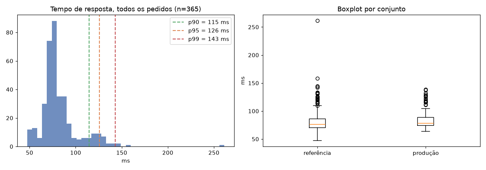
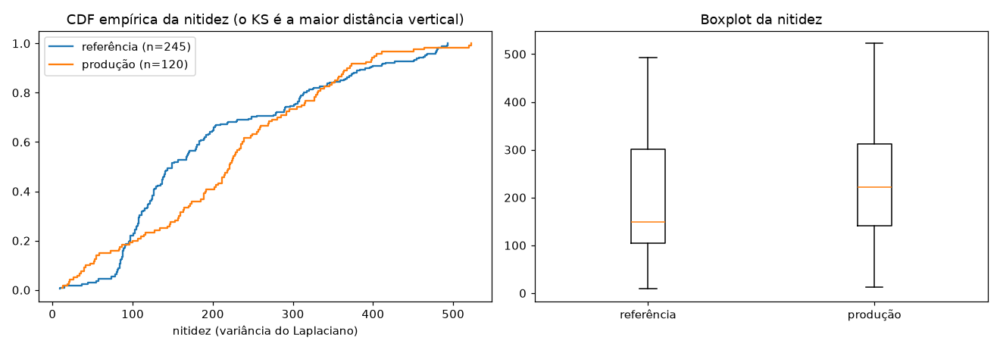
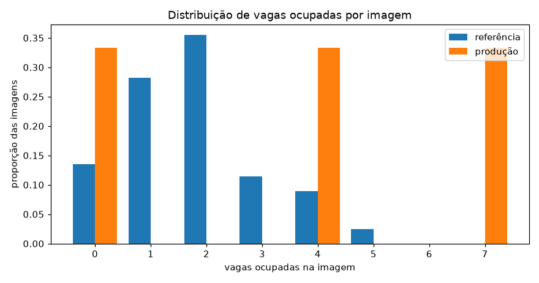

# Relatório de estatísticas de monitoramento

Gerado em 2026-11-24T15:55:18-03:00 por `scripts/relatorio_estatisticas.py`, a partir de `respostas_referencia.csv` e `respostas_producao.csv`. Só entram pedidos com status 200.

## 1. Tempo de resposta de `POST /prever_ocupacao`

Medido no cliente, do envio até a resposta completa, um pedido por vez (sem concorrência), depois de 3 pedidos de aquecimento descartados.

| Conjunto | n | mín | p25 | p50 | p75 | **p90** | **p95** | **p99** | máx | IQR | IC 95% do p95 | > 400 ms |
|---|---:|---:|---:|---:|---:|---:|---:|---:|---:|---:|---|---:|
| referência | 245 | 47,4 | 70,4 | 76,1 | 86,1 | **109,8** | **125,1** | **144,2** | 261,3 | 15,7 | 116,9 a 132,2 | 0,0% |
| produção | 120 | 64,0 | 74,3 | 78,4 | 88,9 | **116,7** | **126,3** | **136,3** | 138,7 | 14,6 | 116,7 a 132,0 | 0,0% |
| todos | 365 | 47,4 | 71,5 | 76,9 | 86,4 | **114,7** | **125,6** | **142,9** | 261,3 | 14,9 | 120,1 a 131,5 | 0,0% |

Valores em milissegundos.

**SLA de exemplo (p95 < 400 ms):** atendido. O p95 de todos os pedidos é 125,6 ms (IC 95% de 120,1 a 131,5 ms), e 0,0% dos pedidos passaram de 400 ms.

**Como ler o p99 com n = 365:** o p99 fica na posição 361,36 dos tempos ordenados, ou seja, entre o 5º e o 4º maior tempo. Ele depende de poucos pedidos e oscila muito entre execuções; o p95 é mais estável, e por isso é o percentil usado em SLAs.

## 2. Conjuntos submetidos

| Conjunto | Origem | Imagens válidas (status 200) |
|---|---|---:|
| referência | 245 fotos de treino do modelo (`train-maquete/images`) | 245 |
| produção | variações realistas das 3 fotos de `samples/` (`scripts/gerar_producao.py`) | 120 |

## 3. Variável de entrada: `nitidez` (contínua → KS)

A nitidez (variância do Laplaciano) é um número real não negativo, então é contínua e o critério é a distância de Kolmogorov-Smirnov.

| Conjunto | n | p25 | mediana | p75 |
|---|---:|---:|---:|---:|
| referência | 245 | 105,0 | 148,9 | 300,9 |
| produção | 120 | 141,3 | 221,3 | 311,7 |

**KS: D = 0,253**, p-valor = 4.97e-05. Com α = 0,05, as distribuições são diferentes (drift). D é a maior distância vertical entre as duas CDFs: em algum valor de nitidez, as proporções de imagens abaixo dele diferem em 25,3 pontos percentuais.

## 4. Variável de saída: `ocupadas` (discreta → PSI)

`ocupadas` é um inteiro de 0 a 7 (a maquete tem 7 vagas), bem abaixo do limite de 100 valores do enunciado, então é discreta e o critério é o PSI, com uma faixa por valor.

| ocupadas | % referência | % produção | contribuição ao PSI |
|---:|---:|---:|---:|
| 0 | 13,5% | 33,3% | 0,1800 |
| 1 | 28,2% | 0,0% | 3,5340 |
| 2 | 35,5% | 0,0% | 4,5382 |
| 3 | 11,4% | 0,0% | 1,3310 |
| 4 | 9,0% | 33,3% | 0,3194 |
| 5 | 2,4% | 0,0% | 0,2475 |
| 6 | 0,0% | 0,0% | 0,0000 |
| 7 | 0,0% | 33,3% | 4,2390 |

**PSI = 14,389** → drift (< 0,1 estável; 0,1 a 0,25 mudança moderada; > 0,25 drift).

